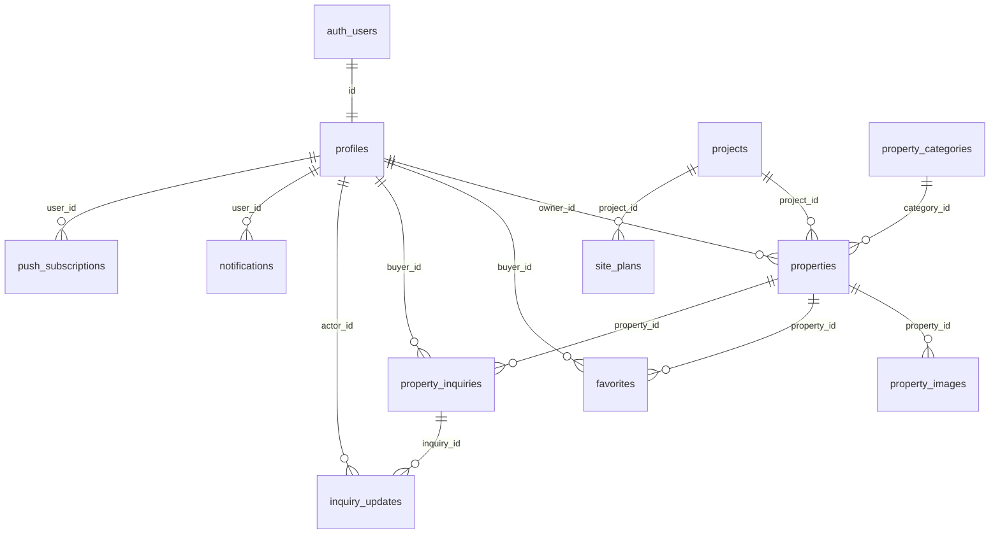

# ERD & Integritas Data (SRS §7)

## Tabel

| Tabel | Field penting |
|---|---|
| `profiles` | `id` (= auth.users.id), `full_name`, `phone`, `role`, `is_active` |
| `projects` | `name`, `slug`, `description`, `address`, `latitude`, `longitude`, `is_active` |
| `property_categories` | `name`, `slug`, `is_active` |
| `properties` | `project_id`, `owner_id`, `category_id`, `slug`, `title`, `description`, `price`, `land_area`, `building_area`, `bedrooms`, `bathrooms`, `address`, `latitude`, `longitude`, `business_status`, `verification_status`, `verification_note`, `verified_by`, `verified_at` |
| `property_images` | `property_id`, `storage_path`, `alt_text`, `sort_order`, `is_primary` |
| `favorites` | `buyer_id`, `property_id` (unique) |
| `property_inquiries` | `buyer_id`, `property_id`, `inquiry_type`, `message`, `status` |
| `inquiry_updates` | `inquiry_id`, `actor_id`, `old_status`, `new_status`, `note` |
| `site_plans` | `project_id`, `file_path`, `version`, `approved_for_use` |
| `notifications` | outbox Web Push (type, title, body, url, dedupe_key, status) |
| `push_subscriptions` | endpoint, kunci, revoked_at |

## Constraint & trigger

| Objek | Aturan |
|---|---|
| `profiles` | FK ke `auth.users(id)` cascade; phone `+62…`; trigger profil otomatis |
| `projects`/`categories` | slug unik & URL-friendly; koordinat berpasangan |
| `properties` | slug unik; harga ≥ 0; luas > 0; koordinat berpasangan & dalam rentang; FK project/owner/category `RESTRICT` |
| `property_images` | unique `(property_id, sort_order)`; satu primary per listing (partial unique) |
| `favorites` | unique `(buyer_id, property_id)` |
| `property_inquiries` | satu pengajuan aktif per `(buyer_id, property_id)` (partial unique); pesan ≤ 1000 |
| `inquiry_updates` | catatan ≤ 500 |
| trigger | `handle_new_user`, `protect_profile_fields`, `guard_verification_status`, `guard_business_status` (terjual final), `guard_inquiry_status` (matriks + final) |
| RLS | aktif di semua tabel; policy publik/pembeli/agen/admin |

Migrasi: `prisma/migrations/20261106090000_srs_baseline/migration.sql`.
